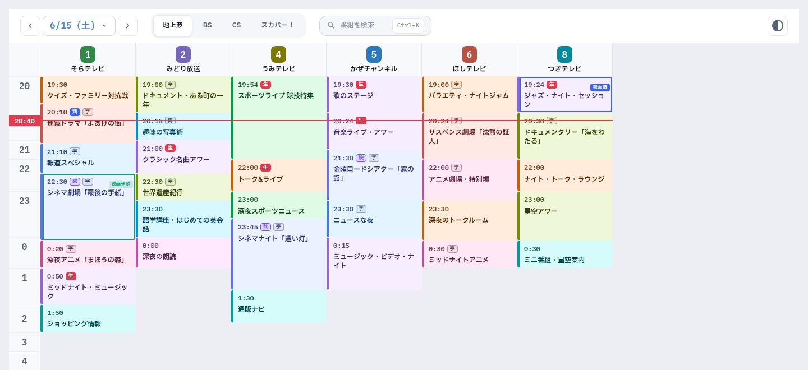
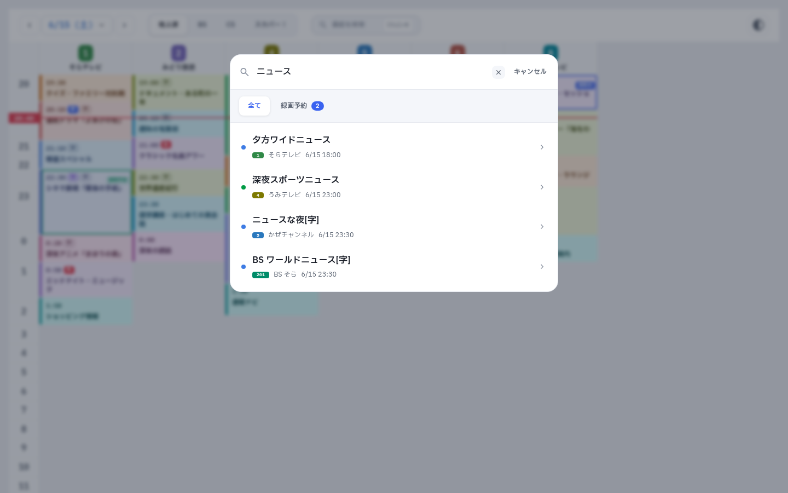
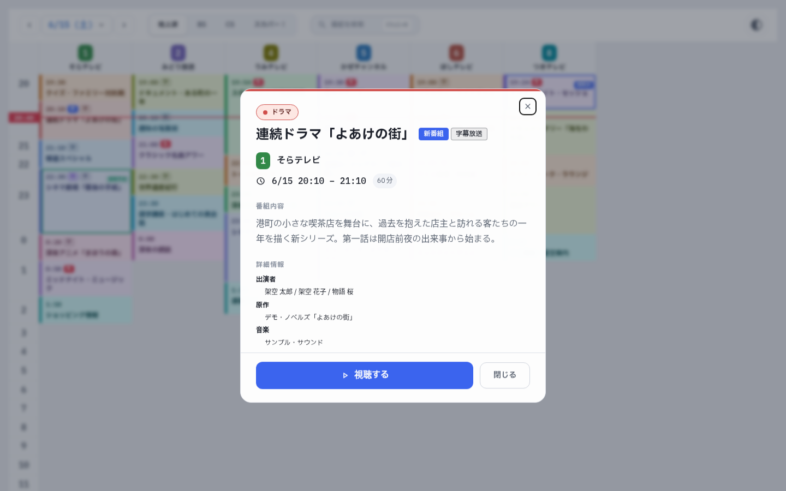
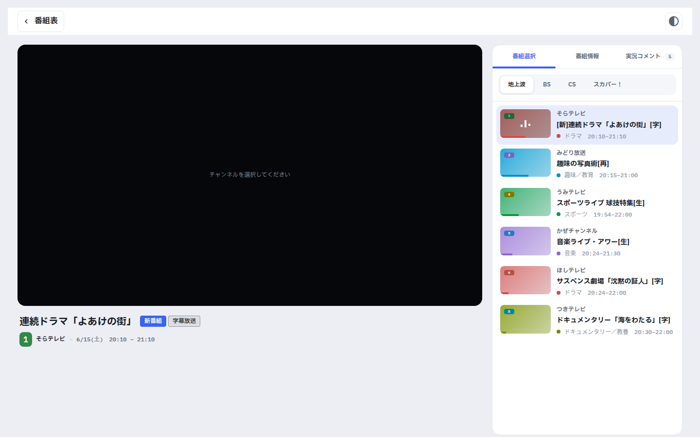

# mirakc-ui

A Web UI for [mirakc](https://github.com/mirakc/mirakc).

Browse the program guide, search programs, schedule recordings, and watch live —
all from your browser.

## Screenshots

> The screenshots use fictional channels and programs; no real broadcast data is
> shown.

<table>
  <tr>
    <td align="center" width="50%">
      <br>
      <sub>Program guide</sub>
    </td>
    <td align="center" width="50%">
      <br>
      <sub>Search</sub>
    </td>
  </tr>
  <tr>
    <td align="center" width="50%">
      <br>
      <sub>Program details &amp; recording reservation</sub>
    </td>
    <td align="center" width="50%">
      <br>
      <sub>Live viewing</sub>
    </td>
  </tr>
</table>

## Install

First, enable
[mirakc's recording reservation feature](https://mirakc.github.io/dekiru-mirakc/latest/config/recording.html).

Add the following to `docker-compose.yml`.

```yml:docker-compose.yml
services:
  mirakc:
    image: mirakc/mirakc:alpine
    init: true
    restart: unless-stopped
    ports:
      - 40772:40772
    volumes:
      - ./config.yml:/etc/mirakc/config.yml:ro
    environment:
      TZ: Asia/Tokyo
      RUST_LOG: info
  # Add the service below.
  ui:
    image: ghcr.io/ansanloms/mirakc-ui:latest
    ports:
      - 8888:8000
    volumes:
      - ./mirakc-ui-data:/app/data
    environment:
      MIRAKC_URL: http://mirakc:40772
      TZ: Asia/Tokyo
```

`TZ` sets the time zone used for recording notifications and recording file
names. Without it they are in UTC.

mirakc-ui stores its settings (e.g. keyword recording rules) in a SQLite
database at `/app/data/settings.sqlite3`. Mount this directory as shown above so
the settings survive container recreation.

When the database is empty (the `kv` table does not exist yet), the `*.sql`
files in `server/initdb.d` (`/app/server/initdb.d` in the image) are run in name
order to seed initial data. The bundled one registers the live-comment channel
assignments for the physical channels of the Kanto region; physical channel
numbers map to different stations in other regions, so replace it before the
first launch there. Databases that already have the `kv` table are not seeded.
To seed something else, point `DATA_INIT_DIR` at a directory of your own `*.sql`
files, or mount one over `server/initdb.d`.

The init SQL runs after the `kv` table is created, inside a single transaction.
Do not write `BEGIN`, `COMMIT` or `ROLLBACK`, and do not create the `kv` table.
If any statement fails, everything is rolled back and startup stops.

> Settings saved by the Deno-based releases (0.10.x and earlier, stored in
> `kv.sqlite3`) are not carried over. Re-enter them after upgrading. The old
> file is left untouched and can be deleted.

After launching, open <http://localhost:8888/>.

## Hardware encoding (VAAPI)

Live viewing transcodes to H.264 with ffmpeg. By default the encoder is
detected at runtime (`h264_vaapi`, then `h264_v4l2m2m`, then `libx264`), so
without a GPU device it falls back to software encoding.

To use VAAPI, pass the render node to the container. The path inside the
container must be `/dev/dri/renderD128`.

```yml:docker-compose.yml
  ui:
    # ...
    devices:
      - /dev/dri/renderD128:/dev/dri/renderD128
```

Set `VIDEO_ENCODER` to `h264_vaapi`, `h264_v4l2m2m` or `libx264` to pin the
encoder. A pinned encoder does not fall back to the others; if it is unusable,
live viewing fails.

The image bundles only the Mesa VA drivers (for AMD Radeon GPUs). It does not
include a driver for Intel GPUs, so `h264_vaapi` is unusable on them. This has
been verified only on an AMD Radeon 760M with Mesa. If hardware encoding causes
problems, set `VIDEO_ENCODER=libx264` to switch back to software encoding.

## Third-Party Notices

mirakc-ui itself is MIT licensed (see [LICENSE](./LICENSE)). The live-comment
feature references the following third-party works, each used as a reference
implementation or as derived data rather than bundled verbatim. All are MIT
licensed.

- **[NDGRClient](https://github.com/tsukumijima/NDGRClient)** — The NDGR
  (Niconico's post-2024/08 message server) receive flow in
  `server/lib/comments/sources/nicolive.ts` is implemented with reference to it.
  The nicolive channel IDs in `server/initdb.d/001-live-comment-defaults.sql`
  also originate from its channel-ID map.
- **[nicolive-comment-protobuf](https://github.com/n-air-app/nicolive-comment-protobuf)**
  — The Protobuf field numbers decoded in `server/lib/comments/ndgr.ts` come
  from its schema definitions (`proto/dwango/nicolive/chat/`).
- **[NX-Jikkyo](https://github.com/tsukumijima/NX-Jikkyo)** and
  **[KonomiTV](https://github.com/tsukumijima/KonomiTV)** — The legacy Niconico
  comment-server protocol in `server/lib/comments/sources/nx-jikkyo.ts` is
  implemented with reference to KonomiTV's `LiveCommentManager.ts` and
  NX-Jikkyo.

<details>
<summary>MIT License (NDGRClient / NX-Jikkyo / KonomiTV: Copyright (c) tsukumi; nicolive-comment-protobuf: Copyright (c) n-air-app)</summary>

```
MIT License

Copyright (c) 2021-2026 tsukumi
Copyright (c) 2024 n-air-app

Permission is hereby granted, free of charge, to any person obtaining a copy
of this software and associated documentation files (the "Software"), to deal
in the Software without restriction, including without limitation the rights
to use, copy, modify, merge, publish, distribute, sublicense, and/or sell
copies of the Software, and to permit persons to whom the Software is
furnished to do so, subject to the following conditions:

The above copyright notice and this permission notice shall be included in all
copies or substantial portions of the Software.

THE SOFTWARE IS PROVIDED "AS IS", WITHOUT WARRANTY OF ANY KIND, EXPRESS OR
IMPLIED, INCLUDING BUT NOT LIMITED TO THE WARRANTIES OF MERCHANTABILITY,
FITNESS FOR A PARTICULAR PURPOSE AND NONINFRINGEMENT. IN NO EVENT SHALL THE
AUTHORS OR COPYRIGHT HOLDERS BE LIABLE FOR ANY CLAIM, DAMAGES OR OTHER
LIABILITY, WHETHER IN AN ACTION OF CONTRACT, TORT OR OTHERWISE, ARISING FROM,
OUT OF OR IN CONNECTION WITH THE SOFTWARE OR THE USE OR OTHER DEALINGS IN THE
SOFTWARE.
```

</details>
